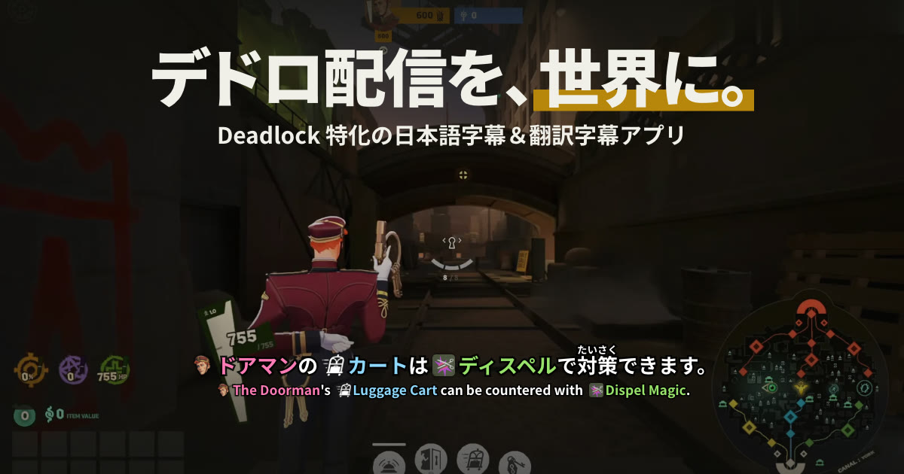
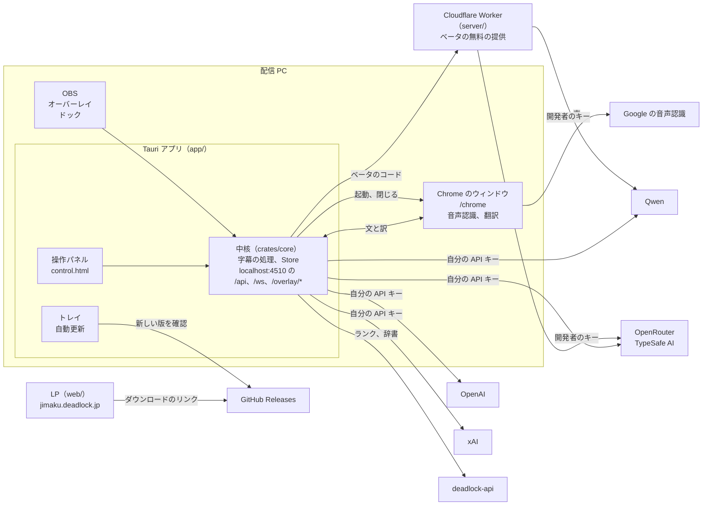
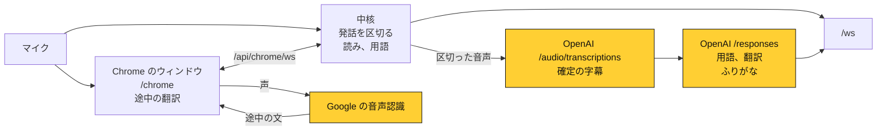
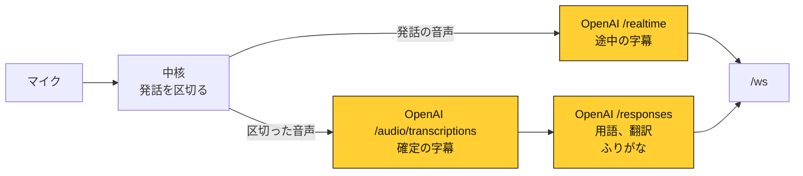
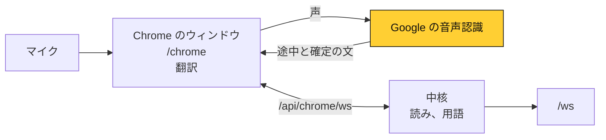

<div align="center">

<a href="https://jimaku.deadlock.jp"></a>

# デドロ配信を、世界に。

Deadlock に特化した、配信者向けの日本語字幕＆翻訳字幕アプリ（非公式）

[](https://github.com/Chiji1108/deadlock-jimaku/releases/latest)
[](https://github.com/Chiji1108/deadlock-jimaku/releases)
[](https://discord.gg/QdVFzMBBD2)
[](https://jimaku.deadlock.jp)

<br>

[](https://github.com/Chiji1108/deadlock-jimaku/releases/latest/download/deadlock-jimaku_x64-setup.exe)
[](https://github.com/Chiji1108/deadlock-jimaku/releases/latest/download/deadlock-jimaku_universal.dmg)
[](https://github.com/Chiji1108/deadlock-jimaku/releases/latest/download/deadlock-jimaku_amd64.AppImage)

<sub>Windows 10 / 11 ・ macOS 11 以降（Apple シリコン・Intel）・ Linux（AppImage ／ <a href="https://github.com/Chiji1108/deadlock-jimaku/releases/latest/download/deadlock-jimaku_amd64.deb">.deb</a> ／ <a href="https://github.com/Chiji1108/deadlock-jimaku/releases/latest/download/deadlock-jimaku.x86_64.rpm">.rpm</a>）</sub>

</div>

---

## できること

- 💬 **字幕** — マイクの声をリアルタイムに字幕にし、ふりがなと翻訳（最大 4 言語）を付ける。ヒーロー・アイテム・スキルの名前はアイコン付きで強調する
- 🏆 **ランク** — ランクのアイコン・名前・ポイントのゲージ
- 🃏 **アイテム説明** — 字幕でアイテム名が出たら、その説明をゲーム内と同じカードで出す

## はじめかた

1. **ダウンロード** — 上のボタンから、使う PC に合ったものを入れます。2 PC 配信なら、配信用の PC（マイクと OBS がある方）に入れます
2. **OBS に追加** — アプリの画面のボタンを OBS にドラッグするだけです
3. **字幕を始める** — まずは無料の Chrome のモード（既定）で、キーなしで始まります

> [!NOTE]
> 既定のモードは途中の字幕を Chrome で作るので、**Google Chrome が必要**です。字幕を始めると小さな Chrome のウィンドウが開きます（クラウドとローカルのモードは Chrome を使いません）。

<details>
<summary><b>初めて開くとき</b></summary>

macOS 版は Apple の署名と公証を済ませています。Windows 版はまだコード署名をしていないので、初回は警告が出ます。

- **Windows**: 「Windows によって PC が保護されました」と出たら、「詳細情報」→「実行」
- **macOS**: dmg を開いて、アプリを「アプリケーション」にドラッグする。初回にマイクの使用を許可する
- **Linux**: AppImage は「プログラムとして実行」を許可してから開く（`chmod +x` でも可）。API キーの保存に Secret Service（GNOME キーリングや KWallet）を使う

</details>

## モード

字幕の作り方はモードから選べます。設定はアプリの操作パネルから行います。

| モード | 料金 | ひとこと |
|---|---|---|
| **Chrome**（既定） | 無料 | Chrome の音声認識と翻訳だけを使う。サーバーを使わない |
| **おすすめ** | ベータ期間中は無料 | 確定の字幕・用語・翻訳を、デドロ字幕のサーバーを通して高精度に作る |
| **Chrome+** | 無料 | Chrome の中の AI で用語を判定する。VRAM 8 GB 以上推奨 |

<details>
<summary><b>その他のモード</b></summary>

| モード | 料金 | ひとこと |
|---|---|---|
| **最高精度** | OpenAI の API キー | 用語の判定と文字起こしがいちばん正確 |
| **クラウド** | ベータ期間中は無料 | Chrome を開かず、音声を Google に送らない。使用メモリ最小 |
| **ローカル** | 無料 | PC の中の AI だけで作り、外に送らない。VRAM 12 GB 以上推奨 |

</details>

「モード」のタブで、工程（途中の字幕・確定の文字起こし・用語・翻訳・ふりがな）ごとに作り方を変えることもできます。

---

<div align="center">

**🛠️ ここから下は開発する人向けです**

</div>

## しくみ

開発する人のための地図です。理由は [DESIGN.md](DESIGN.md) を見てください（モードは 9.6、開発者のサーバーと LP は 17 章）。

字幕を何で作るかは、工程ごとの選択（設定の `engines`。モードを選ぶとまとめて決まる）と設定から `Settings::plan` が決めます（`crates/core/src/settings.rs`。操作パネルのモードはおすすめ（コードの中の名前は `beta`）・Chrome・最高精度（表の「スタンダード」）で、ほかの組み合わせは「モード」のタブで工程ごとに選びます。この表は、鍵の要る組み合わせを含む 3 つの組み合わせ（`Engines::STANDARD` など）の値で、テストに同じ値があります）。工程を 1 つ変えると、確定の欄はその工程の行だけが変わります。

| | スタンダード | OpenAI | Chrome |
|---|---|---|---|
| 途中の字幕 | Chrome | GPT-Live-Transcribe | Chrome |
| 途中の翻訳 | Chrome Translator | なし | Chrome Translator |
| 途中のふりがな | 辞書 | 辞書 | 辞書 |
| 途中の強調 | 辞書の一致 | 辞書の一致 | 辞書の一致 |
| 確定の字幕 | GPT-Transcribe | GPT-Transcribe | Chrome |
| 確定の翻訳 | GPT-6.1 Terra | GPT-6.1 Terra | Chrome Translator |
| 確定のふりがな | 辞書 + GPT-6.1 Terra | 辞書 + GPT-6.1 Terra | 辞書 |
| 確定の強調 | GPT-6.1 Terra | GPT-6.1 Terra | 辞書の一致 |

翻訳先がない、翻訳だけを見せる、ふりがなやデッドロックモードを切る、話す言語が日本語でない（読みの辞書と用語の一致は日本語だけ）ときは、その項目が「なし」になります。

確定の文字起こしが Grok Voice Transcribe のとき（工程ごとに選んだとき）は xAI の API キーが要ります。

「おすすめ」のモード（`Engines::BETA`。表にはありません）は、ベータ期間中、API キーなしで無料で使えます。途中の字幕は Chrome、確定の字幕は Qwen-Audio-3.1-ASR-Flash、用語は Perplexity Decider、翻訳は Hy-MT2、ふりがなは辞書の候補から Perplexity Decider が選び、開発者のサーバーが開発者のキーで中継します（`server/src/beta.ts`。DESIGN.md 17.2）。

用語と翻訳は、表の 4 つのモードでは 1 回の問い合わせ（GPT）か、辞書の一致と Chrome の翻訳です。詳しく選ぶと、2 つを別々に作れます（DESIGN.md 9.7）。用語は、PC の中で出した候補を判定モデルに確かめさせます（`decide.rs`。OpenAI の Decisions API、TypeSafe AI の Jev、OpenRouter の Drex Max・Microsoft Decision 1・Perplexity Decider）。翻訳は、用語を英語名に置き換えた文を Chrome か翻訳専門のモデル（`mt.rs`。Qwen-MT-Flash か OpenRouter の Hy-MT2）に渡します。途中の字幕と確定の文字起こしは、Qwen-Audio-3.1-ASR-Flash も選べます（`stt/qwen.rs`。DESIGN.md 3.4）。確定の文字起こしは、OpenRouter の MAI-Transcribe 2 と、PC の中で動く Haas-ja（`local.rs`。speech.cpp を初回にダウンロードします。DESIGN.md 9.8）も選べます。「おすすめ」のモードのほかは、その会社の自分の API キーが要ります。作れない組み合わせは `Engines::sanitized` が直します。確定の文字起こしが Chrome なら途中の字幕も Chrome（発話の区切りを Chrome が決める）、Chrome の翻訳は途中の字幕が Chrome のときだけです。翻訳を GPT にしたときは、用語も同じ問い合わせで判定します（訳文の名前を用語から作るので）。確定の文には、どちらの経路でも `finish.rs` が工程ごとに用語・ふりがな・翻訳を付け、1 つの字幕にまとめます。



- 操作パネルは Tauri のウィンドウでも OBS のドックでも同じ画面で、`/api` と `/ws` だけを使います。
- OpenAI のモード以外では、アプリが専用のプロファイルの Chrome を起動します。音声認識と翻訳は Chrome が行い、ふりがなと辞書の一致は中核の中で行います（vibrato と話し言葉の UniDic）。
- OpenAI と xAI、TypeSafe AI には、自分の API キーで直接送ります。Qwen と OpenRouter は、ベータのコードがあれば Worker を通し（開発者のキー。「おすすめ」のモード）、なければ自分の API キーで直接送ります。Worker は会社ごとに同じパスで中継するので、アプリは送り先を替えるだけです。

### 声と文字の流れ

図はモードごとの処理の順です（確定の文字起こしが OpenAI か xAI なら上の 2 つ、Chrome なら 3 つ目の経路）。黄色は PC の外です。OpenAI とのやりとりは、すべて中核が行います。字幕は `/ws` でオーバーレイと操作パネルに届きます。

**`standard`（スタンダード）。** 途中の字幕は Chrome で作ります。発話が終わると、アプリのマイクの声と文字を OpenAI に送ります。Chrome にも同じマイクを渡します（渡せない環境では Chrome の既定のマイクを使い、操作パネルに出します）。



**`openai`（OpenAI）。** 途中の字幕も OpenAI で作ります。途中の字幕を「出さない」にすると、Realtime にはつなぎません。



**`chrome`（Chrome）。** 音声認識も翻訳も Chrome で行い、声は Chrome を通じて Google に送られます。読みと用語は中核で付け、OpenAI には何も送りません。



読みと辞書の一致は話す言語が日本語のときだけ動きます。ほかの言語でも Chrome は認識するので、字幕は出ます。

## リリースの作り方

使う人に関係のある変更があれば、`CHANGELOG.md` にその版の内容を書きます（更新したあとの最初の起動で、アプリがこの内容を出します。プレリリースの間は、本リリースの版の見出しに書き足します）。`Cargo.toml` の `version` を上げてコミットし、同じ版のタグ（例: `v0.2.0`。`-` の付いた `v0.2.0-rc.1` はプレリリース）を push すると、GitHub Actions が 3 つの OS のインストーラーを作って下書きのリリースに載せます（`.github/workflows/release.yml`）。プレリリースでは `.rpm` を作りません。中身を確かめてから GitHub で公開します。PR と main でも同じビルドが走り（`build.yml`）、作ったインストーラーは Actions の成果物から落とせます。

macOS 版の署名と公証には、リポジトリの Actions の Secrets に次を入れておきます（リリースのときだけ使い、PR と main ではアドホック署名）。

| Secret | 中身 |
|---|---|
| `APPLE_CERTIFICATE` | Developer ID Application 証明書（1 つだけ）の `.p12` を base64 にしたもの |
| `APPLE_CERTIFICATE_PASSWORD` | `.p12` を書き出したときのパスワード |
| `APPLE_API_ISSUER` | App Store Connect の API キーの Issuer ID |
| `APPLE_API_KEY` | 同じく Key ID |
| `APPLE_API_KEY_P8` | 同じく `.p8` ファイルの中身 |

自動更新の署名には、`TAURI_SIGNING_PRIVATE_KEY` と `TAURI_SIGNING_PRIVATE_KEY_PASSWORD` も入れておきます。

## 開発

```bash
mise install
pnpm install
mise run dev
```

整形・リント・型チェック・テストは `mise run check` でまとめて実行します。

使っているアプリを動かしたまま、別の場所で起動して試せます。`DEADLOCK_JIMAKU_DATA_DIR`（設定と辞書を置くフォルダ）と `DEADLOCK_JIMAKU_PORT`（ポート）を付けます。フォルダを替えると、API キーも別の名前で持つので、使っているアプリのキーは読みません。

```bash
pnpm --dir frontend build
DEADLOCK_JIMAKU_DATA_DIR=/tmp/jimaku-dev DEADLOCK_JIMAKU_PORT=4599 cargo run -p overlays-core --bin overlays-headless
```

操作パネルは `http://127.0.0.1:4599/` で開きます。

報告や提案に AI を使うときは、[AI の利用について](AI_POLICY.md)を読んでください。

## ライセンス

[PolyForm Strict License 1.0.0](LICENSE.md)。ソースは公開していますが、改変や再配布はできません。個人の利用はできます（詳しくは本文を見てください）。

<sub>参考にしたプロジェクト: [音声認識字幕ちゃん](https://github.com/sayonari/jimakuChan)（sayonari さん。Chrome の音声認識の扱いの設計）、[ゆかりねっとコネクター NEO](https://nmori.github.io/yncneo-Docs/)（Chrome の音声認識を選ぶきっかけ）。ありがとうございます。</sub>
