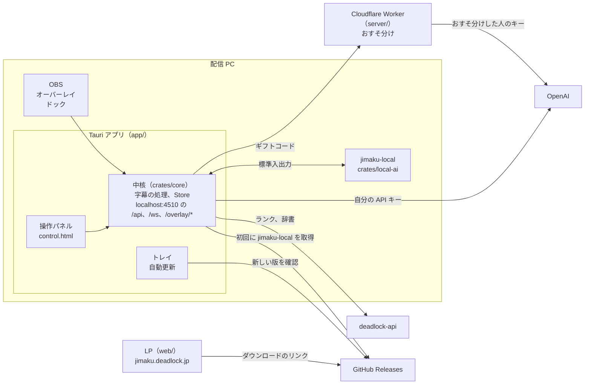
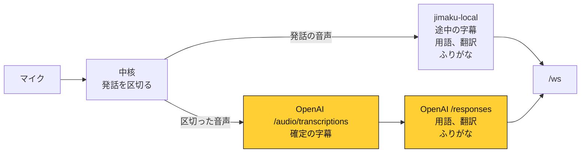
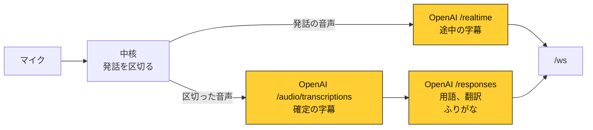
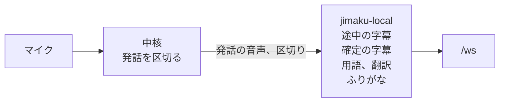

# デドロ字幕

Deadlock の配信者向けの OBS オーバーレイ（非公式）。

- **字幕**: マイクの声をリアルタイムに字幕にし、ふりがなと翻訳（最大 4 言語）を付ける。ヒーロー・アイテム・スキルの名前はアイコン付きで強調する
- **ランク**: ランクのアイコン・名前・ポイントのゲージ
- **アイテム説明**: 字幕でアイテム名が出たら、その説明をゲーム内と同じカードで出す

字幕の作り方は 3 つのモードから選べます。ハイブリッド（既定）と OpenAI は API キーかギフトコード、ローカルAI はキーなしで使えます。設定はアプリの操作パネルから行います。

サイトは [jimaku.deadlock.jp](https://jimaku.deadlock.jp)。設計は [DESIGN.md](DESIGN.md) を見てください。

## インストール

[Releases](https://github.com/Chiji1108/deadlock-jimaku/releases) から、使う PC に合ったものをダウンロードします。2 PC 配信なら、配信用の PC（マイクと OBS がある方）に入れます。

| OS | ファイル |
|---|---|
| Windows 10 / 11 | `deadlock-jimaku_x64-setup.exe` |
| macOS 11 以降（Apple シリコン・Intel） | `deadlock-jimaku_universal.dmg` |
| Linux | `.AppImage`（どのディストリビューションでも）、`.deb`（Ubuntu など）、`.rpm`（Fedora など） |

macOS 版は Apple の署名と公証を済ませています。Windows 版はまだコード署名をしていないので、初回は警告が出ます。

- **Windows**: 「Windows によって PC が保護されました」と出たら、「詳細情報」→「実行」
- **macOS**: 初回にマイクの使用を許可する
- **Linux**: API キーの保存に Secret Service（GNOME キーリングや KWallet）を使う

## しくみ

開発する人のための地図です。理由は [DESIGN.md](DESIGN.md) を見てください（モードは 9.6、おすそ分けは 17.1、LP は 17 章）。



- 操作パネルは Tauri のウィンドウでも OBS のドックでも同じ画面で、`/api` と `/ws` だけを使います。
- `jimaku-local` はローカルAI の別プロセスです。アプリに入れず、使う人だけ、初回にダウンロードします。アプリは SHA-256 を確かめてから起動します。モデルは `jimaku-local` がダウンロードします。
- 自分の API キーがあれば OpenAI へ直接送ります。なければギフトコードで Worker を通します。Worker は同じパスで中継するので、下の図の OpenAI はどちらの経路でも同じです。

### 声と文字の流れ

モードは設定の `speechEngine` で決まります。図は処理の順で、黄色は PC の外です。OpenAI や `jimaku-local` とのやりとりは、すべて中核が行います。字幕は `/ws` でオーバーレイと操作パネルに届きます。

**`hybrid`（ハイブリッド）。** 途中の字幕は PC の中で作ります。発話が終わると、声と文字を OpenAI に送ります。



**`openai`（OpenAI）。** 途中の字幕も OpenAI で作ります。途中の字幕を切ると、Realtime にはつなぎません。



**`local`（ローカルAI）。** すべて PC の中で作ります。OpenAI には何も送りません。



ローカルAI は話す言語が日本語のときだけ動きます。`hybrid` では、ローカルAI で訳せない言語を確定のあとに OpenAI が訳します。

## リリースの作り方

`Cargo.toml` の `version` を上げてコミットし、同じ版のタグ（例: `v0.2.0`。`-` の付いた `v0.2.0-rc.1` はプレリリース）を push すると、GitHub Actions が 3 つの OS のインストーラーと `jimaku-local` のアーカイブを作って下書きのリリースに載せます（`.github/workflows/release.yml`）。プレリリースでは `.rpm` を作りません。中身を確かめてから GitHub で公開します。PR と main でも同じビルドが走り（`build.yml`）、作ったインストーラーは Actions の成果物から落とせます。

macOS 版の署名と公証には、リポジトリの Actions の Secrets に次を入れておきます（リリースのときだけ使い、PR と main ではアドホック署名）。

| Secret | 中身 |
|---|---|
| `APPLE_CERTIFICATE` | Developer ID Application 証明書（1 つだけ）の `.p12` を base64 にしたもの |
| `APPLE_CERTIFICATE_PASSWORD` | `.p12` を書き出したときのパスワード |
| `APPLE_API_ISSUER` | App Store Connect の API キーの Issuer ID |
| `APPLE_API_KEY` | 同じく Key ID |
| `APPLE_API_KEY_P8` | 同じく `.p8` ファイルの中身 |

自動更新の署名には、`TAURI_SIGNING_PRIVATE_KEY` と `TAURI_SIGNING_PRIVATE_KEY_PASSWORD` も入れておきます。

## 開発

```bash
mise install
pnpm install
mise run dev
```

`mise run dev` は `jimaku-local` もビルドします。整形・リント・型チェック・テストは `mise run check` でまとめて実行します。

## ライセンス

[PolyForm Strict License 1.0.0](LICENSE.md)。ソースは公開していますが、改変や再配布はできません。個人の利用はできます（詳しくは本文を見てください）。
